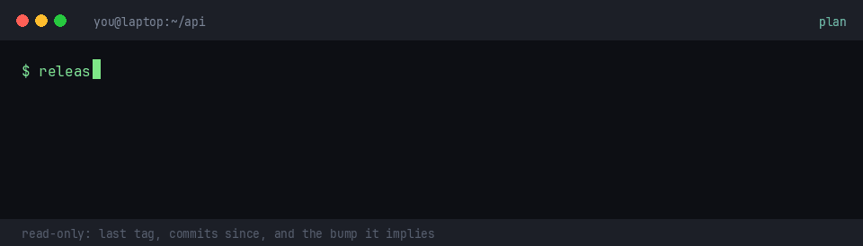

# release

<h3 align="center">Conventional commits → SemVer, changelog, release PR/MR, tag and release.</h3>

<p align="center">
  <a href="LICENSE"></a>
  
  
  
</p>

> One flow for GitHub and GitLab: `plan` is read-only, `apply --yes` opens the PR, `tag --yes` releases.

Works in **pi · Claude Code · Codex · Cursor** and any agent that reads a `SKILL.md` — plain
Markdown plus one stdlib script, no agent-specific tools.

<p align="center">
  
</p>

## What it is

`release` reads the last tag and the commits since it, decides major/minor/patch, prints the changelog it would write, then (with `--yes`) writes the version into every file it found, prepends `CHANGELOG.md`, branches, commits `chore(release): vX.Y.Z`, pushes and opens the PR/MR. A separate `tag` step releases after the merge.

## Why it exists

Release scripts rot into one repo's layout. This one detects the provider from `origin`, scans the version files it knows, and refuses to run on a dirty tree, a detached HEAD, or a branch behind its remote.

## Install

```bash
# Claude Code — the whole collection as one marketplace
claude plugin marketplace add Appit-labs/appit-skills
claude plugin install release@appit-skills

# pi
pi install git:github.com/Appit-labs/release

# any agent that reads a skills directory
git clone git@github.com:Appit-labs/release.git
cp -r release/skills/release ~/.claude/skills/      # or ~/.codex/skills/, .cursor/skills/, …
```

## Requires

- `git`, plus `gh` (GitHub) or `glab` (GitLab), authenticated
- Conventional commits (`feat:`, `fix:`, `feat!:`)

## Cost

| | tokens |
| --- | --- |
| always-on — the description, paid every session | ~95 |
| on invoke | ~1.6k |

The demo is a real run: `demos/release.json` holds the captured output and `tools/make_demo.py` renders it.

## Provenance

Every command in this skill was run against a real target before it was written down: a live
database, a staging host, a failing CI run, a browser session. The repository was created and
published on 2026-11-18; where the workflow itself is older, `CHANGELOG.md` carries the dates.

## Security

SkillSpector: **0/100, SAFE, 0 open findings** against the committed baseline; every accepted
finding is listed with its reason in [SECURITY.md](SECURITY.md).

## Part of the Appit collection

[appit-skills](https://github.com/Appit-labs/appit-skills) — browser QA · CI triage · Postgres ·
runbooks · SSH · Trello · cloud browsers · OpenDesign · Blender · code scan · release · Hermes.

## License

MIT, copyright Appit Labs. See [LICENSE](LICENSE).
